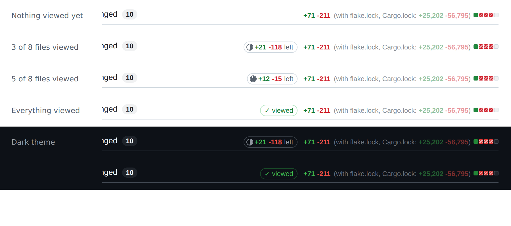

# GitHub PR Diffstat Filter

A browser extension (Chrome/Chromium and Firefox, Manifest V3) that replaces GitHub's PR line
counts with counts that leave out files matching your patterns, such as lockfiles. The original
counts stay next to them in brackets:

```
+71 −211 (with flake.lock, Cargo.lock: +25,202 −56,795)
```

The filtered numbers go exactly where GitHub's were, so the header layout barely changes.
Hover over the numbers to see which files were excluded and their line counts. The filtered numbers
appear only when at least one file matches **and** at least one doesn't, so a PR that only
bumps `flake.lock` keeps GitHub's plain numbers.

Once you mark files as *Viewed*, a pill to the left of the diffstat shows what is left to review: the
line counts without the viewed files, and a pie that fills up with the share of lines you have
been through. It turns into a green *✓ viewed* when nothing is left. Hover over it to see the
viewed files. This needs a token (see below).



It works in the PR header on every PR tab (conversation, commits, checks) and in the classic
"Files changed" diffstat.

## Install

Chrome / Chromium / Brave / Edge:
1. `chrome://extensions` → enable *Developer mode* → *Load unpacked* → pick this directory.

Firefox (121+):
1. `about:debugging#/runtime/this-firefox` → *Load Temporary Add-on…* → pick `manifest.json`.
   This install is removed when Firefox restarts. For a permanent install, sign the add-on
   through addons.mozilla.org (it can stay unlisted), e.g. with `web-ext sign`.

Then click the extension's toolbar icon to adjust the patterns and, optionally, add a token.
The options open as a popup (pin the icon from the extensions menu to keep it in the toolbar).

## Options

**Excluded paths**: one gitignore-style pattern per line. Matching is case-insensitive.

| Pattern             | Matches                                           |
|---------------------|---------------------------------------------------|
| `flake.lock`        | `flake.lock` in any directory                     |
| `nix/flake.lock`    | only at that path from the repo root              |
| `*.snap`            | any `.snap` file, at any depth                    |
| `vendor/`           | everything under any `vendor` directory           |
| `docs/**/gen.md`    | `docs/gen.md`, `docs/a/b/gen.md`, …               |

Defaults: common lockfiles (`flake.lock`, `Cargo.lock`, `package-lock.json`, `yarn.lock`,
`pnpm-lock.yaml`, `bun.lock`, `go.sum`, `poetry.lock`, `uv.lock`, `Gemfile.lock`, `composer.lock`).

**GitHub token**: optional. The extension calls the REST API: `GET /pulls/:n` on each PR view,
and `GET /pulls/:n/files` (one request per 100 files) only when the head commit changes. Without
a token that works for public repos up to the 60 requests/hour limit. For more headroom or for
private repos, create a
[fine-grained token](https://github.com/settings/personal-access-tokens/new) with read-only
access:
- public repos only: *Repository access → Public repositories*, no permissions needed;
- private repos: select them and grant *Pull requests: Read-only*.

**Tokens for specific organizations**: optional. A fine-grained token is tied to one resource
owner, so a single token cannot cover private repositories of several organizations. Add one
token per organization (or user) name; it is used for every request about a PR in that owner's
repositories, including the *left to review* marks, and the default token is used everywhere
else. Names are matched case-insensitively. *Check tokens* tests all of them.

**Left to review**: on by default, and can be switched off. Which files you marked as viewed is
only available from GitHub's GraphQL API, which always needs a token, and it is the token
owner's marks that are shown, so use a token of your own account. This adds one GraphQL request
per 100 files on each PR view. Files that match the excluded patterns are left out of the pill
as well, viewed or not. A file that changed after you viewed it counts as not viewed, as on GitHub.

The tokens live in `storage.local` (never synced) and are only sent to `api.github.com`.

## Notes

- GitHub's files API lists at most 3000 files. The extension subtracts the excluded files from
  the PR totals, so any files past that limit count as kept (the tooltip says when that happens).
- Only github.com is supported. GitHub Enterprise would need its own host in `manifest.json` and
  its own API base URL.
- If a request fails (rate limit, private repo without a token, bad token), a ⚠ appears next to
  the diffstat. Its tooltip gives the reason, and which token was used.
- The extension finds the diffstat by GitHub's success/danger colour classes and only annotates
  pairs whose numbers equal the PR totals from the API. If GitHub changes its markup,
  `findDiffstatPairs` in `src/content.js` is the place to update.

## Development

```sh
npm install        # Playwright, only needed for the e2e check
npm test           # unit tests for pattern matching and the arithmetic
GH_TOKEN=... npm run e2e -- https://github.com/logos-co/logos-chat-module/pull/76
VIEWED=README.md,src/a.rs GH_TOKEN=... npm run e2e -- <pr-url>   # pretend these files are viewed
npm run package    # zip for store upload
```
